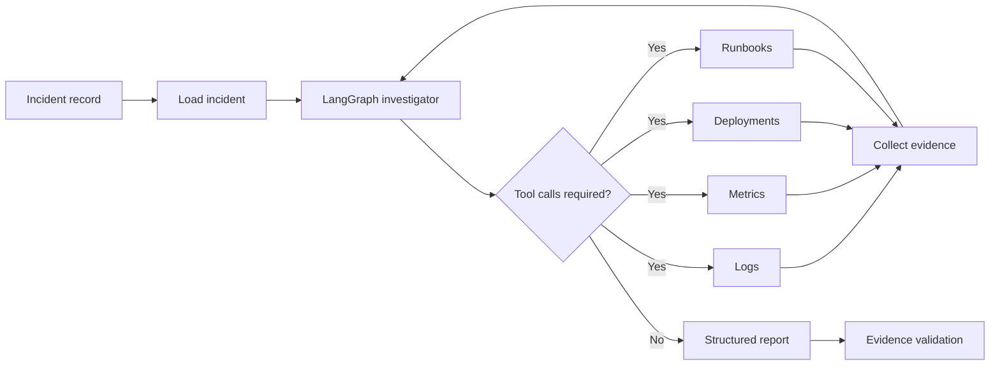

# Incident Response Copilot

An evidence-based incident investigation agent built with LangChain and LangGraph. It correlates logs, metrics, deployments and operational runbooks, then produces a structured root-cause report with traceable evidence IDs.

The project demonstrates how an AI agent can support site reliability and platform teams while keeping conclusions grounded in observable system data.

## Current status

- [x] Create a synthetic incident dataset
- [x] Implement log search
- [x] Implement metric search
- [x] Implement deployment search
- [x] Implement runbook search
- [x] Define typed investigation state and report schemas
- [x] Build a LangGraph tool-calling workflow
- [x] Generate structured incident reports with Ollama
- [x] Validate report evidence against collected tool results
- [x] Add isolated tool and graph tests
- [ ] Add a larger labelled evaluation dataset
- [ ] Evaluate root-cause accuracy and evidence recall
- [ ] Expose investigations through a FastAPI service
- [ ] Add human approval before remediation actions
- [ ] Add tracing and workflow observability

## How it works



The investigator receives the incident metadata and decides which tools to call. LangGraph executes those tools, adds their results to the conversation and stores normalized evidence in the shared state. When the investigation is complete, a separate structured-output call creates an `IncidentReport`.

The final report is rejected if it references an evidence ID that was not returned by a tool.

## Example incident

The included `INC-001` scenario represents an increase in checkout failures and latency. The available evidence includes:

- database connection timeout logs;
- database pool, HTTP error-rate and latency metrics;
- a deployment that reduced `DB_POOL_MAX_SIZE` from 30 to 5;
- a database connection troubleshooting runbook.

The agent correlates these sources and identifies database connection pool exhaustion as the likely root cause.

## Project structure

```text
incident-response-copilot/
├── data/
│   ├── incidents/          # Incident descriptions
│   ├── logs/               # JSON Lines application logs
│   ├── metrics/            # Time-series metric samples
│   ├── runbooks/           # Operational runbooks
│   └── deployments.json    # Deployment history
├── evaluation/
│   └── incident_cases.json # Labelled evaluation cases
├── scripts/
│   └── investigate.py      # CLI entry point
├── src/
│   ├── agent/
│   │   ├── graph.py        # LangGraph workflow
│   │   ├── nodes.py        # Investigation and report nodes
│   │   └── state.py        # Typed state and report schemas
│   ├── incidents/
│   │   └── repository.py   # Incident loader
│   ├── tools/
│   │   ├── deployment_search.py
│   │   ├── log_search.py
│   │   ├── metric_search.py
│   │   └── runbook_search.py
│   └── config.py
└── tests/
```

## Technology stack

- Python 3.12
- LangChain
- LangGraph
- Ollama and `ChatOllama`
- Pydantic
- Pytest

## Installation

Clone the repository and create a virtual environment:

```bash
git clone https://github.com/amirsasani/incident-response-copilot.git
cd incident-response-copilot

python -m venv .venv
source .venv/bin/activate
pip install -r requirements.txt
```

Create the local configuration file:

```bash
cp .env.example .env
```

The default configuration is:

```dotenv
OLLAMA_BASE_URL=http://localhost:11434
OLLAMA_MODEL=qwen3.5:4b
MAX_TOOL_CALLS=8
```

Install and start the configured Ollama model:

```bash
ollama pull qwen3.5:4b
ollama serve
```

## Run an investigation

```bash
python -m scripts.investigate --incident_id INC-001
```

Example output:

```json
{
  "incident_id": "INC-001",
  "affected_service": "checkout-api",
  "root_cause": "Deployment of version 1.8.0 reduced the database connection pool size from 30 to 5.",
  "confidence": 0.9,
  "evidence": [
    "deployment-001",
    "runbook-db-001",
    "metric-003"
  ],
  "recommended_actions": [
    "Roll back to the previous configuration or restore DB_POOL_MAX_SIZE.",
    "Monitor database connection-pool utilization."
  ],
  "needs_human_review": true
}
```

Results can vary between local model runs. Every returned evidence ID is checked against evidence collected during that investigation.

## Tests

Run the test suite with:

```bash
python -m pytest
```

The tests cover:

- incident loading and input validation;
- filtering logs and metrics;
- deployment time filtering;
- runbook retrieval;
- Pydantic state validation;
- LangGraph tool execution and evidence collection;
- structured report generation without a live Ollama dependency.

## Evaluation plan

`evaluation/incident_cases.json` contains labelled incidents with an expected service, root cause and required evidence IDs.

The planned evaluation will measure:

- root-cause accuracy;
- required evidence recall;
- invalid citation rate;
- investigation latency;
- unnecessary tool calls;
- human-review decisions.

## Safety design

The copilot produces recommendations but does not execute remediation commands. Reports default to `needs_human_review=true`, keeping rollback and configuration changes under human control.

## Limitations

- The current dataset contains one synthetic incident.
- Retrieval tools operate on local fixture files rather than production observability systems.
- Small local models may select weaker evidence even when stronger evidence is available.
- Investigation latency depends on the local model and hardware.
- The project currently provides a CLI and does not expose an HTTP API or graphical interface.

## Roadmap

1. Add incidents covering memory leaks, failed deployments, queue backlogs and dependency outages.
2. Implement automated evaluation for root-cause accuracy and evidence recall.
3. Add FastAPI endpoints for starting and retrieving investigations.
4. Add LangSmith or OpenTelemetry tracing.
5. Integrate realistic observability adapters for systems such as Prometheus, Loki and Kubernetes.
6. Add checkpointing and human approval before remediation.

## License

This project is licensed under the Apache License 2.0. See [LICENSE](LICENSE).
